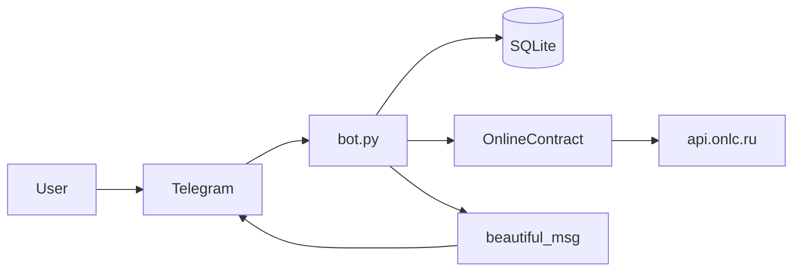

# Архитектура приложения

| Документ | О чём |
|----------|--------|
| [`database.md`](database.md) | SQLite: таблицы, репозитории, миграции Alembic и как бот этим пользуется |
| [`fetch_modules.md`](fetch_modules.md) | Клиент `OnlineContract`: процедуры и позиции с публичного API `api.onlc.ru` |
| [`misc.md`](misc.md) | Окружение: `TOKEN`, `DATABASE_URL`, `ADMIN_IDS` и загрузка корневого `.env` |
| [`utils.md`](utils.md) | Текст карточек для Telegram, кнопки категорий и разбор `callback_data` (`tgbot/ui`) |
| [`testing.md`](testing.md) | Запуск pytest и короткая ручная проверка в Telegram |

Прайс-лист один на всех. Если задан `PRICE_LIST_PATH`, читается он. Иначе `data/price-list.xls`, если файл есть; иначе самый большой `.xls` в `data/` (имя с «ОПТ» важнее), иначе устаревший каталог `docs/research/` (в git не входит). `price-list.prev.xls` и `price-list.pending.xls` в этот выбор не попадают. Команда `/price` записывает путь из `PRICE_LIST_PATH` или `data/price-list.xls` и перед заменой копирует прежний файл в `data/price-list.prev.xls`.

Достоверное описание потоков и границ компонентов. Детали реализации — в исходниках и в профильных файлах [`docs/`](.).

## Назначение

Telegram-бот на **aiogram 3.x** запрашивает у публичного API **onlinecontract.ru** (`api.onlc.ru`) список открытых процедур по выбранным категориям и отдаёт пользователю карточки; по кнопке загружает позиции (конкурсный лист) по процедуре.

## Внешние источники и ограничения

| Источник | Для чего смотреть |
|----------|-------------------|
| [Telegram Bot API](https://core.telegram.org/bots/api) | Лимиты сообщений (4096 символов), callback_data (до 64 байт), flood control, `deleteMessage` (не старше 48 часов), `my_chat_member`, `setMyCommands` |
| [aiogram 3.x](https://docs.aiogram.dev/en/latest/) | Обработчики, `Bot`, `Dispatcher`, middleware, HTML parse mode, scope команд |
| Код [`onlinecontract/client.py`](../onlinecontract/client.py) | Фактические URL и query к `api.onlc.ru` (публичная спецификация площадки в репозитории не хранится) |

## Структура репозитория (логические слои)

```text
bot.py                 — запуск: python bot.py вызывает tgbot.app.main
tgbot/app.py           — Bot, Dispatcher, middleware, фоновые задачи
tgbot/user.py          — /start, /help, /clear и callback процедур
tgbot/admin.py         — команды владельца: сводка, список, карточка, бан, разбан, сброс диалога, удаление профиля, загрузка общего прайса .xls
tgbot/middleware.py    — сессия БД на update и запрет «доступ закрыт»
tgbot/dialogs.py       — сброс диалога: треки сообщений, deleteMessage, снятие закрепа
tgbot/ui/              — текст карточек, кнопки категорий, разбор callback
jobs/backups.py        — снимок файла SQLite владельцам, когда вышел срок и база изменилась
jobs/intersection_feed.py — раз в 15 минут ищет конкурсные листы и постит пересечения с прайсом: «подходит» тем, кто нажал /start и не закрыт, плюс id из ADMIN_IDS; «пограничный» только владельцам
jobs/match_cards.py    — текст карточки пересечения и кнопки «Позиции», «Подходит», «Не подходит»
matching/               — сопоставление с прайсом: категории видов товара, эмбеддинги, уровень «подходит» / «пограничный»
db/                    — персистентный слой (подробно — database.md)
alembic/               — миграции схемы
onlinecontract/        — синхронный HTTP-клиент к API (вызов из asyncio через to_thread)
misc/                  — TOKEN (TgKeys), загрузка .env (load_env.py), DATABASE_URL (db_url.py), ADMIN_IDS (admins.py)
```

Персистентность (SQLite, SQLAlchemy async, Pydantic, Alembic, кэш и трекинг сообщений) описана в **[`database.md`](database.md)** — здесь не дублируется.

## Поток данных



1. `/start` в личном чате записывает человека в журнал. Если доступ закрыт, бот отвечает «доступ закрыт» и меню категорий не показывает.
2. Пользователь выбирает категорию → `callback_data` из [`tgbot/ui/keyboards.py`](../tgbot/ui/keyboards.py) → `_ensure_procedures` (кэш в БД или запрос) → `OnlineContract.get_procedures` (в `to_thread`).
3. Карточки процедур рендерятся через `beautiful_procedure`; пагинация — callback вида `m|<offset>|<cat_str>` (см. [`tgbot/user.py`](../tgbot/user.py)).
4. «Позиции» → `pos_<id>` → `get_positions` → `beautiful_positions`; длинный текст режется через `split_telegram_messages`.
5. `/help` отвечает текстом-справкой; владельцу в личном чате к нему добавляются команды из `tgbot/admin.py`. `/clear` пытается удалить до 30 последних сообщений чата и саму команду. Журнал `bot_message_tracks` эта команда не использует.

## Пользователи и доступ

Журнал тех, кто нажал `/start` в личке, и команды владельца. Таблицы и флаг сброса — в [`database.md`](database.md).

- Запись создаётся на `/start`: id, имя, фамилия, username, язык, время старта и последнего захода. Текст сообщений не хранится. Повторный `/start` обновляет имя и username.
- Владельцы задаются списком **`ADMIN_IDS`** (числовые id). Меню команд в их личном чате шире (`setMyCommands` со scope чата). Обработчик всё равно сверяет id: scope в апдейт не приходит.
- Закрытый доступ (`/ban` и подтверждённое `/delete_user`) оставляет строку с `telegram_user_id`. Оба действия не выполняются для id из `ADMIN_IDS`. Новый `/start` и остальные действия отвечают «доступ закрыт». Удаление профиля стирает имя и username, запрет остаётся. `/unban` снова пускает человека; имя подтянется на следующем `/start`. `/user <id>` показывает карточку.
- Сброс диалога (`/reset`, а также бан и удаление) снимает закреп и удаляет сообщения бота из `bot_message_tracks` (`welcome`, `procedures`, `positions`). Кэш процедур при этом не очищается. Сообщения старше 48 часов Telegram не удаляет.
- Один раз при старте процесса, пока в `app_kv_store` нет флага `dialog_reset_all_v1`, бот так же сбрасывает диалог во всех чатах, которые уже есть в базе. Следующие запуски этот проход пропускают. Очередь непрочитанных апдейтов по-прежнему отбрасывается (`drop_pending_updates=True`).
- `my_chat_member` в личке помечает, что человек сам заблокировал или снова открыл бота. Id человека берётся из `from_user`: в `new_chat_member.user` приходит бот.
- Раз в **`DB_BACKUP_INTERVAL_HOURS`** (по умолчанию 24) каждый id из `ADMIN_IDS` получает файл базы, если содержимое с прошлой попытки изменилось. Время попытки и хэш лежат в `app_kv_store` (`db_backup_state`) и переживают перезапуск. В хэш не входят сама эта запись и поля `updated_at`, поэтому отметка о копии и повторная запись тех же данных не выглядят изменением базы. Пока срок не вышел, новый процесс ждёт остаток интервала. **`DB_BACKUP_ON_START`** по умолчанию `0`: если в момент старта срок уже вышел или копии ещё не было, процесс не шлёт файл сразу, а ставит попытку на полный интервал от этого старта. `1` отправляет просроченную копию сразу. Неизменившаяся база файл не присылает, но попытка запоминается, и следующий срок считается от неё. Это снимок через SQLite backup, а не копия открытого файла. Для базы в памяти отправка пропускается.
- Раз в **`MATCH_POLL_INTERVAL_MINUTES`** (по умолчанию 15) бот запрашивает список активных процедур и сравнивает id со снимком `match_active_procedure_ids` в `app_kv_store`. Рядом, в `match_poll_state`, лежат отпечаток файла прайса и версия правил. Если отпечаток или версия изменились, классифицируется весь активный список, а не только новые id. Уже отправленные в чат id процедур при этом снова не приходят. Версия правил меняется вместе с категориями, списком отключённых категорий (`MATCH_DISABLED_CATEGORIES`), порогами и словарём ложных друзей. Позиции активного листа перечитываются не чаще раза в сутки (`POSITION_REFRESH_SECONDS`), и тогда лист сопоставляется снова. Прайс и эмбеддинги не вызываются, когда новых id нет, прайс и правила те же и позиции свежее суток. Классификатор — пакет `matching`. Строка попадает в категорию прайса, если несколько ближайших позиций достаточно близки и в основном из одной включённой категории. Объём, вес, фасовка, материал и бренд решение не принимают. Словарь ложных друзей по-прежнему отсекает услуги и чужой профиль. У листа один уровень: «подходит», если средний косинус строк в категориях не ниже `FIT_MIN_COSINE`, иначе «пограничный». «Подходит» уходит каждому, кто нажал `/start` и не закрыт (`is_banned`) и не помечен `bot_blocked`, и каждому id из `ADMIN_IDS`, у которого ещё нет строки в `telegram_users`. «Пограничный» — только id из `ADMIN_IDS`. Личный чат совпадает с id человека: `send_message(user_id)`. Текст для всех начинается как карточка процедуры: ссылка вида «имя заказчика[id]», наименование, НДС и блок «Условия» (оплата и сроки поставки), когда эти поля есть. Под последним фрагментом — кнопка «Позиции» (`pos_<id>`). Владелец дополнительно видит уровень, категории, «N из M», строки «похоже на» и кнопки «Подходит» / «Не подходит». Ответы пишутся в `match_labels`. Корзины exact/disputed в карточке не пишутся. Процедура, уже отправленная в этот чат, больше не отправляется: журнал `shown_procedures` считает её показанной по паре `(chat, procedure_id)`. Неудачная загрузка позиций или отправка в чат оставляет id вне снимка. Пустая или резко укороченная выдача снимок не затирает. Первый запуск без снимка берёт уже скачанный список процедур как базу и не рассылает его заново; если этого списка нет, один раз проверяется текущая активная выдача. Посты не входят в `bot_message_tracks` и не стираются командой `/start`. Если прайс старше `PRICE_MAX_AGE_DAYS`, владельцы получают предупреждение не чаще раза в сутки; сопоставление из-за возраста не останавливается. Когда запись `price_upload` указывает на текущий файл, дата берётся из исходного имени (если в имени даты нет — из `uploaded_at`); иначе из имени файла или из времени файла. Сбой этой проверки приходит каждому id из `ADMIN_IDS` одним коротким сообщением с ⚠️, без трассировки и секретов. Сообщение, что файл прайса не найден, — алерт только для id из `ADMIN_IDS` (не тем, кто нажал `/start`): один раз за простой и удаляется, когда файл снова находится (`match_price_missing_notice`, не `bot_message_tracks`). Ключ эмбеддингов — `OPENAI_API_KEY` в корневом `.env`. Полный расчёт эмбеддингов прайса сам не стартует. Новые названия считаются, только когда владелец нажимает «Посчитать» (платный вызов модели), под тем же замком, что и классификация этого опроса. Из консоли по-прежнему: `MATCH_ALLOW_CATALOG_EMBED=1 python -m matching.run --embed-catalog`. Файлы ТЗ не скачиваются.

Журнал живёт в файловой базе. При `DATABASE_URL` по умолчанию (SQLite в памяти) записи пропадают вместе с процессом, и однократный сброс не видит чаты прошлого запуска.

## Согласованность данных

- Кнопки категорий: кортеж **`onlc_text_and_data`** и множество **`CATEGORY_CALLBACK_IDS`** в [`tgbot/user.py`](../tgbot/user.py) должны совпадать по вторым элементам (строка id для API).

## Пакеты (углублённо)

- HTTP и модель ответов API: [`fetch_modules.md`](fetch_modules.md)
- Токен и окружение: [`misc.md`](misc.md), [`example.env`](../example.env)
- База данных, миграции, ORM: [`database.md`](database.md)
- Тексты и HTML: [`utils.md`](utils.md)
